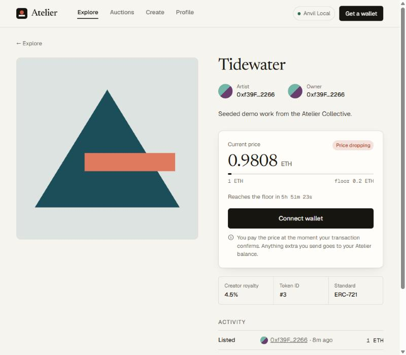
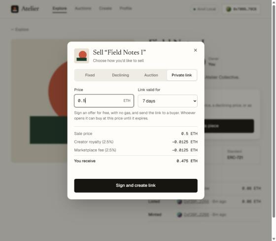
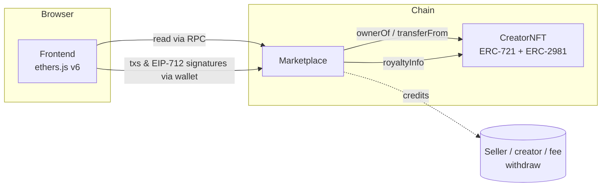

# Atelier — NFT Marketplace

An NFT marketplace for independent artists, built with Solidity, Foundry and a hand-written frontend in plain JavaScript (no framework). Artists mint work with on-chain metadata and set their own royalty. Collectors can buy at a fixed price, buy in a declining-price (Dutch) auction, bid in a timed English auction, or buy through a gasless private sale link signed with EIP-712.

[](https://github.com/noshock/atelier-nft-marketplace/actions/workflows/test.yml)

**Live demo:** [noshock.github.io/atelier-nft-marketplace](https://noshock.github.io/atelier-nft-marketplace/) (Sepolia testnet; connect MetaMask and use free Sepolia ETH)

| Contract (Sepolia) | Address |
|---|---|
| Marketplace | [`0x2Bf043768E6AA5b287c47EDbC1232A0a05312146`](https://sepolia.etherscan.io/address/0x2Bf043768E6AA5b287c47EDbC1232A0a05312146) |
| CreatorNFT | [`0xa97c4cc304f0ce63bB90ab4114f65E6Fa224BC45`](https://sepolia.etherscan.io/address/0xa97c4cc304f0ce63bB90ab4114f65E6Fa224BC45) |
| MarketLib | [`0x2B096e96d361184F063f6c8650D848B2429C2052`](https://sepolia.etherscan.io/address/0x2B096e96d361184F063f6c8650D848B2429C2052) |

All three are source-verified on [Sourcify](https://repo.sourcify.dev/11155111/0x2Bf043768E6AA5b287c47EDbC1232A0a05312146).


| Dutch auction with live price decay | Sell flow with live payout breakdown |
|---|---|
|  |  |

## Highlights

- **Four ways to sell** in one contract: fixed price, Dutch auction, English auction, and off-chain signed orders
- **ERC-2981 royalties**, read defensively: capped at 10%, and ignored if the collection's `royaltyInfo` reverts or is missing
- **Pull-payment architecture**: no sale or auction can be blocked by a recipient that rejects ETH
- **Anti-sniping**: a bid in the last 10 minutes extends the auction
- **EIP-712 + ERC-1271**: signed orders work with normal wallets and with smart-contract wallets
- **50 tests**: unit, fuzz and invariant tests, with **99% line coverage**
- **Polished frontend**: live countdowns, falling prices, payout previews, approval steps, readable error messages, mobile layout

## Architecture



| Contract | Responsibility |
|---|---|
| [`CreatorNFT.sol`](src/CreatorNFT.sol) | Open-edition ERC-721. The minter becomes the royalty receiver (0–10%). Supports `data:` URIs so artwork can be stored fully on-chain. |
| [`Marketplace.sol`](src/Marketplace.sol) | Listings, Dutch and English auctions, signed orders, fee and royalty accounting, withdrawals, admin pause. Works with **any** ERC-721, not only `CreatorNFT`. |
| [`MarketLib.sol`](src/libraries/MarketLib.sol) | Externally linked library: EIP-712/ERC-1271 signature checks and defensive ERC-2981 royalty lookup. |

### How a sale is split

```
price ─┬─ royalty   = min(ERC-2981 amount, 10%)  → creator's credits
       ├─ fee       = price × feeBps (≤ 5%)       → fee recipient's credits
       └─ remainder                              → seller's credits
```
Every party calls `withdraw()` to collect. A fuzz test proves the three parts always add up to exactly the price.

## Design decisions

| Decision | Why |
|---|---|
| **Pull payments (`credits` + `withdraw`)** instead of sending ETH during a sale | If a seller, creator or outbid bidder is a contract that rejects ETH, a push payment would revert and freeze the sale or auction forever. `test_EthRejectingBidderCannotBlockAuction` shows this attack failing. |
| **Listings leave the NFT in the seller's wallet; auctions escrow it** | Listings cost nothing to cancel and the seller keeps custody. Auctions must guarantee delivery to the winner, so the NFT is locked. |
| **Stale listing check** (`ownerOf == seller`) | If a seller transfers the NFT after listing, a buyer gets a clear `ListingStale` error instead of a confusing transfer revert. The frontend hides stale listings. |
| **`transferFrom` (not `safeTransferFrom`) when settling auctions** | A winner contract that can't receive NFTs must not stop the seller from being paid. Buyers who call `buy()` themselves get `safeTransferFrom`. |
| **Dutch and fixed share one struct** | A fixed price is a Dutch auction with `startPrice == endPrice`. One code path, fewer bugs. |
| **Overpayment is credited back** | Dutch prices fall every second, so buyers can send a small buffer safely. |
| **Pause stops trading but never exits** | `cancelListing`, `cancelAuction`, `settleAuction` and `withdraw` work while paused, so users can always get their assets out. |
| **Custom errors** everywhere | Cheaper than revert strings, and the frontend maps each one to a plain-language message. |
| **Signature and royalty logic in a linked library, compiled with `via_ir`** | The first Sepolia deploy ran out of gas: contract creation on Sepolia now costs ~1,600 gas per byte of code, so the 12.6 KB Marketplace needed 20.3M gas, above the 16.78M per-transaction cap (EIP-7825). Moving self-contained logic into `MarketLib` and enabling the IR optimizer cut it to 9.8 KB, which deploys for 15.97M. |

## Security considerations

- **Reentrancy**: every state-changing external function that moves value is `nonReentrant` and follows checks-effects-interactions. `test_ReentrancyFromReceiveHookIsBlocked` re-enters from `onERC721Received` and is rejected.
- **Signature replay**: orders carry a per-seller `nonce` and `deadline` and are bound to chain id and contract address through the EIP-712 domain. Sellers can cancel a nonce at any time.
- **Malicious royalty contracts**: royalties are capped, and `royaltyInfo` is called inside `try/catch` after an ERC-165 check.
- **Fee bounds**: the owner can never set the fee above 5%.
- **Frontend**: all on-chain strings (titles, descriptions) are HTML-escaped, and image URLs are restricted to `https:` and `data:image/`, so a malicious token URI can't inject script.
- **Known limitation**: `block.timestamp` is used for auction timing. Validators can shift it by a few seconds, which doesn't matter at 15-minute-plus granularity.

## Testing

```bash
forge test                       # 50 tests
forge test --match-contract Invariant -vv
forge coverage --report summary --no-match-coverage "(script|test)"
```

| Suite | What it covers |
|---|---|
| `CreatorNFT.t.sol` | Minting, royalty cap, interfaces, royalty-math fuzz |
| `Marketplace.t.sol` | Every sale path, every revert, admin and pause, reentrancy, griefing and hostile-royalty attacks |
| Fuzz tests | Sale split conserves value; Dutch price stays bounded and never rises; every outbid bidder is fully refundable |
| `MarketplaceInvariant.t.sol` | A handler drives random mint, list, buy, bid, settle, withdraw and time-warp sequences (8,192 calls per run). It checks three invariants: **the contract holds exactly what it owes**, **ETH in = ETH out + balance**, and **live auction NFTs are always in escrow**. |

Coverage:

| File | Lines | Functions |
|---|---|---|
| CreatorNFT.sol | 100% | 100% |
| Marketplace.sol | 98.8% | 96.6% |

## Run it locally

Prerequisites: [Foundry](https://book.getfoundry.sh/getting-started/installation), Node 18+, and a browser wallet such as MetaMask.

```bash
git clone --recursive <this-repo-url> && cd <repo>   # --recursive pulls forge-std
npm install                      # OpenZeppelin contracts
forge build
anvil                            # terminal 1: local chain
npm run deploy:local             # terminal 2: deploy + seed demo art, listings and auctions
npm run frontend                 # serves ./frontend on http://localhost:8080
```

In your wallet:
1. Add the network **Anvil Local**: RPC `http://127.0.0.1:8545`, chain id `31337`. The app also offers a one-click switch.
2. Import one of the test accounts that `anvil` prints, for example account #1. Account #0 is the seller of the demo pieces.

> Already cloned without `--recursive`? Run `git submodule update --init`. OpenZeppelin comes from npm, which avoids Windows "Filename too long" errors that `forge install` can hit in deep folders.

## Deploy to Sepolia

```bash
# One-time: store a throwaway key encrypted on disk (prompts for key + password)
cast wallet import atelier-deployer --interactive

# Deploy, seed demo data and write frontend/deployments/11155111.json
forge script script/Deploy.s.sol --rpc-url sepolia --account atelier-deployer \
  --sender <your-address> --evm-version amsterdam --gas-estimate-multiplier 105 --slow --broadcast
```
- `--evm-version amsterdam` makes Foundry's simulation use Sepolia's current gas schedule. With older rules it underestimates contract creation about 5×, and the deploy runs out of gas.
- `--gas-estimate-multiplier 105` keeps the Marketplace's gas limit under the 16.78M per-transaction cap. The default 130% would exceed it.
- `--slow` sends one transaction at a time and stops on the first failure.
- Set `SEED=false` to deploy without demo data.

Pushing `frontend/` to `main` publishes the site through the **Deploy frontend** workflow. When it's served from anywhere other than `localhost`, the site uses Sepolia automatically.

## Project structure

```
src/
  CreatorNFT.sol           ERC-721 + ERC-2981 collection
  Marketplace.sol          listings, auctions, signed orders, payouts
  libraries/MarketLib.sol  linked library: signatures + royalty lookup
test/
  Base.t.sol               shared fixtures
  CreatorNFT.t.sol
  Marketplace.t.sol        unit + fuzz + attack tests
  invariant/               handler-based invariant suite
  mocks/                   hostile NFTs, reentrant buyer, ETH-rejecting bidder
script/
  Deploy.s.sol             deploy, seed demo data, write frontend config
frontend/
  index.html
  css/styles.css
  js/config.js             networks, ABIs, error messages
  js/chain.js              providers, wallet, error decoding
  js/app.js                router, views, transaction flows
  js/art.js                generative on-chain SVG artwork, metadata
  js/ui.js                 toasts, modals, formatting
```

## Roadmap

- ERC-20 payments (WETH/USDC) next to ETH
- Collection-wide and trait offers (buyer-signed bids)
- A subgraph (The Graph) for indexed activity and search, instead of reading logs in the browser
- IPFS upload for user images (Pinata / web3.storage)
- UUPS upgradeability behind a timelock + multisig owner

## License

MIT
